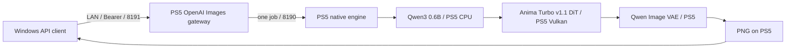

# PS5 AI Anima

Anima Turbo v1.1をPlayStation 5本体のGPUで実行するネイティブアプリと、LAN用の画像生成APIです。

**開発中です。AnimaのPS5実機生成はまだ確認していません。** PS5 AI WAIの実機成功結果をAnimaの成功結果として扱いません。

## 構成

Windowsはビルド・転送・API操作に使用し、モデル推論をWindowsやクラウドへ転送しません。WAIとAnimaは同時起動せず、待機と通常終了を確認して切り替えます。

| 項目 | Anima側の構成 |
|---|---|
| アプリ名 | PS5 AI Anima |
| Title ID候補 | PPSA99189（新規登録・実機確認待ち） |
| 配置先 | `/data/ai/native-anima-turbo-v11/PPSA99189` |
| native API | 8190 |
| OpenAI Images互換部分 | 8191、model `anima-turbo-v1.1` |
| 初回検証 | 512×512、8steps、CFG1、Euler |
| GPU基盤 | WAI由来のnative RADV / owned Direct memory |

SDXL用の漫画LoRA、IP-Adapter、ControlNetをAnima用として流用しません。まずAnima本体のtext-to-imageを接続し、未対応の拡張要求は明確に拒否します。

## モデル

正規配布元は[CircleStone Labs / Anima](https://huggingface.co/circlestone-labs/Anima)です。Turbo v1.1のDiT、Qwen3-0.6B-Base、Qwen-Image VAEの3部品を使います。T5の重みは不要で、SD.cppの内蔵tokenizerを利用します。

モデル重み・認証トークン・個人用ログはこのリポジトリに含めません。[モデルの取得revisionとハッシュ](docs/anima-models.md)、[実機検証状況](docs/status.md)を確認してください。元モデルと変換した重みを区別します。

モデルには[CircleStone Labsの利用条件](https://huggingface.co/circlestone-labs/Anima/blob/main/LICENSE.md)が適用されます。アプリのコードとモデル重みは別の配布物です。

APIの接続先と例は[Anima API](docs/api.md)、設定例は[config/anima-native.json.example](config/anima-native.json.example)です。

## 開発基盤と履歴

[PS5 AI WAI](https://github.com/akiba-tokyo-jp/PS5-AI-WAI)のcommit `86393645bb1f663c78f2cd2ac08ad67fa84e3812`を出発点に、別アプリ・別API・別データ領域として構築しています。既存WAIのバイナリ・設定・登録を上書きしません。

`docs/`のWAI固有の過去ベンチマーク・画像・検証資料は基盤の履歴です。Animaでの実測結果を示すものではありません。[元のREADME](WAI-BASE-README.md)も保存しています。元プロジェクトの著作権・第三者ライセンスは保持します。[第三者ライセンス](THIRD_PARTY_NOTICES.md)。

ビルド基盤は[既存のビルド手順](docs/build.md)を継承しますが、同文書のWAI固有のタイトル・モデル・実機結果はAnimaに適用しません。新規タイトル登録にはホーム画面のメタデータとmountの準備が必要で、通常のファイル転送だけでは完了しません。FWや既存WAIを保護し、必要な変更範囲を確認してから実機反映します。
