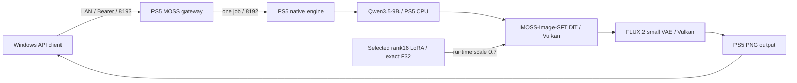

# PS5 AI MOSS Image

MOSS-Image-SFTとユーザー指定LoRAをPS5本体で推論するためのネイティブアプリと、LAN用のOpenAI Images互換APIを準備しています。

**指定構成はMOSS-Image-SFT＋[選択LoRA](docs/moss-requested-lora.md)です。モデル一式の取得・全体SHA256検証、LoRAの正確なF32変換、独立q/k/vの接続、全75-member coreとnative SELFのfresh cross buildまで完了しています。PS5でのLoRA適用・画像生成は未確認です。**

**Private開発版です。MOSSのPS5実機推論・12GiB確保・PNG生成は未確認で、MOSS本体・モデルは未配備です。** compile-time runtime admissionは0を維持し、準備版は明示的AGC/data pool初期化より前で停止します。ビルド成功を実機成功として扱いません。

Windowsは開発・APIクライアントに使います。モデル推論をPCやクラウドへ移しません。WAI・Anima・MOSSは同時起動しません。

| 項目 | 準備した構成 |
|---|---|
| アプリ / 新Title ID候補 | PS5 AI MOSS Image / PPSA99190（未登録） |
| 配置候補 | `/data/ai/native-moss-image-sft/PPSA99190` |
| Native / OpenAI gateway | 8192 / 8193、model `moss-image-sft` |
| モデル | SFT Q4_K + Qwen3.5-9B Q4_K_M + FLUX.2 small VAE + 外部tokenizer + 選定rank16 LoRA |
| Direct予約目標 | **12GiB（12,884,901,888 bytes）**、1GiB regions |
| 推論予算の設定例 | 11.5GiB、pool外のworking reserve 1GiB |
| 基準設定 | Euler、50steps、CFG3、flow shift5、画像辺は16の倍数 |

12GiBはGPU専用の独立VRAMではなく、CPU/GPU共有のDirect領域の目標です。過去のGPU稼働時のDirect総量約11.44GiBと、別のAGC前診断の12GiBは、どちらもpool12GiB + reserve1GiBの容量判定を通りません。仮想アドレスの区切り変更では物理メモリ枠は増えません。実機の割当条件・工程別ピーク・GPU読み戻しを確認するまで、確保可能とは扱いません。

Qwenのembeddingは実GGUFヘッダーで545.625MiBと確認しました。旧512MiB単体割当上限を超えるため、MOSS側のregionを1GiBへ拡張しています。実モデルのロード・数値整合・GPU演算の検証は別工程です。SDXL用LoRA、ControlNet、IP-Adapter、img2img/inpaintingはMOSSへ流用せず、APIで拒否します。

- [現在の検証範囲](docs/status.md)
- [固定モデル・ハッシュ・メモリ・ライセンス](docs/moss-models.md)
- [指定LoRAの実ヘッダー・メモリ・互換対応](docs/moss-requested-lora.md)
- [APIとOpenAPI](docs/api.md)
- [設定例](config/moss-native.json.example)
- [ビルド](docs/build.md) / [配置計画](docs/deployment.md)

[OpenMOSS公式](https://github.com/OpenMOSS/MOSS-Image)と[SD.cppのMOSS対応](https://github.com/leejet/stable-diffusion.cpp/blob/b13a48219d5cdf408edcb93da6cd69b612ed03d3/docs/moss_image.md)を参照しています。実装は既存PS5向けSD.cppへMOSS対応commitを範囲限定で移植し、選定LoRAを含むcore全75オブジェクトを新規再構築しました。最新upstream全体への置換ではありません。

このリポジトリは[PS5 AI WAI](https://github.com/akiba-tokyo-jp/PS5-AI-WAI)とPS5 AI Animaの履歴を継承します。`docs/`に残るWAI/Animaの成功画像・ベンチマーク・検証結果はMOSSの結果ではありません。[Anima元README](ANIMA-BASE-README.md)、[WAI元README](WAI-BASE-README.md)、著作権・[第三者通知](THIRD_PARTY_NOTICES.md)を保持します。ホームアイコンは継承した仮アセットです。

重み・token・個人ログ・ビルド済みバイナリはGitへ含めません。アプリのGPL等と各モデルのApache-2.0条件は別に扱います。実機の正常動作確認まではprivateを維持します。
