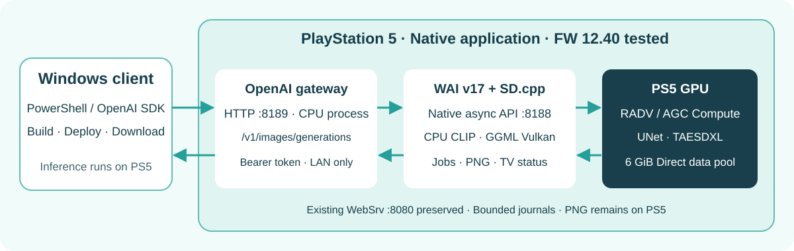

# PS5 AI MOSS Image

**MOSS-Image-SFTをPS5本体で動かすネイティブ画像生成アプリ**です。WindowsからOpenAI Images互換APIで要求し、同じPS5のGPUで生成したPNGを取得します。Windowsは開発・APIクライアントとして使い、全learned推論はPS5内で実行します。

最新の速度基準は **Turbo4＋bounded upload＋DiT融合＋kernel4項目**です。1024平均は **47.481390秒→45.127473秒、4.96%短縮**しました。[最新の実機比較・画像差・メモリ](docs/moss-dit-kernels-20261021.md)、[固定weightsの再現](docs/moss-turbo4-reproduction.md)。

## 同条件での生成時間

2026-10-21、PS5内のgeneration_secondsです。各構成は新しいプロセスで256→1024→1024を生成しました。1024単独coldではありません。

| 構成 | 256初回・モデル読込込み | 256後1024初回 | 1024の2回目 | 1024平均 |
|---|---:|---:|---:|---:|
| 従来のDiT融合版・今回の対照 | 69.111579秒 | 47.800313秒 | 47.162467秒 | 47.481390秒 |
| **FFN／Attention／QKV・LoRA／RMSの改善版** | **69.449735秒** | **45.415880秒** | **44.839066秒** | **45.127473秒** |

4 Euler steps／CFG1、作者の専用sigmas、NSFW0.7＋Turbo1.0の合成rank144 F32 adapterを維持しています。Q4 weights・FP16データ経路と明示的F32累積を使用し、追加20ケースのGPU読み戻し、有限DiT出力4、LoRA504 tensorsの適用、OpenAI互換APIのPNG取得を確認しました。

元のAttention案は遅くなったため不採用とし、shared-KV経路のoccupancyを調整した案を採用しました。旧版と採用版のPNGには画素差があり、同画質を保証しません。各構成2回の順次測定で、温度・clockを統制した統計的比較ではありません。256初回の高速化は確認できていません。Direct予約10GiBは維持し、owned Directの高水位は96MiB増えました。[全構成・数値検証](docs/moss-dit-kernels-20261021.md)。

以前の[DiT融合比較](docs/moss-dit-fusion-20261020.md)では1024が51.146425秒→47.760891秒で、両PNGが完全一致しました。sampling変更を含む[50-stepからの履歴](docs/moss-sampler-spectrum-memory-20261020.md)は同画質の速度比較と区別しています。FFN chunk2048とF16 LoRA storageは読込済み1024の高速化を示せず、最新速度基準ではOFFです。

**公開版は検証用アプリです。** production admissionは既定OFF。固定prompt・seed・256／1024、1native process最大4試行（失敗を含む）の限定trialを公開しています。任意promptの連続運用版は含めません。[確認範囲と制約](docs/status.md)を先に確認してください。

## PS5内の処理

- OpenAI Images互換gateway：PS5の8193、model moss-image-sft。
- 非同期native engine：同じPS5の8192。gatewayはジョブを1件だけ渡します。
- Qwen3.5-9B Q4_K_Mのtext encoding：PS5 CPU。
- MOSS-Image-SFT Q4_KのDiTとFLUX.2 small VAE：PS5 Vulkan、RADV NAVI21。
- text-to-image対応。ControlNet、IP-Adapter、img2img、マスク編集、inpaintingはこのMOSS APIでは未対応です。

前段のGPU timestamp測定では、1024の採取区間でFFN約40%、Attention約25%、QKV約15%でした。この結果に基づいてkernel改善を進めました。[GPU時間の内訳](docs/moss-dit-gpu-profile-20261021.md)／[ComfyUI等の適用評価](docs/moss-dit-reference-evaluation-20261021.md)。

## メモリと実行の境界

PPSA99190として登録・実機起動を確認しています。APIはBearer認証と同じprivate IPv4 /24内の接続に制限し、生成を直列処理します。タイムアウト時はhealthと既存jobを確認し、自動再送しません。GPUアプリは同時起動しません。

物理Direct予約10GiB、推論予算9.5GiB、pool外reserve1GiBです。採用版1024のowned Direct高水位は約5.78GiB。API GPU-labelled値、owned Direct、CPU/process RSSは重複する別の量で加算できません。12GiB予約目標は現native quotaでは未達です。使用量低下と、予約をOSへ返すことは別です。

bounded uploadは同形式GPU重み転送のhost stagingをworkerあたり最大8MiBへ制限します。全推論RAMを8MiBにする機能ではありません。数値・実容量・有限値・GPU完了・所有権の条件を維持し、不確かなGPU資源を手動解放しません。

## 利用・ビルド

- [APIとOpenAPI](docs/api.md)／[PowerShellクライアント](scripts/Invoke-MossOpenAI.ps1)
- [モデル・ハッシュ・ライセンス](docs/moss-models.md)／[Turbo4 adapter再現](docs/moss-turbo4-reproduction.md)
- [ビルド](docs/build.md)／[配置と終了](docs/deployment.md)
- [現在の状態](docs/status.md)／[最新比較](docs/moss-dit-kernels-20261021.md)／[実機検証データ](docs/verification.json)
- [公開前の確認](docs/publication-checks-20261020.md)／[前段のメモリ比較](docs/moss-turbo-memory-options-20261020.md)

SDK・reviewed依存・shader compilerが別途必要で、clone直後のワンコマンド完全構築ではありません。モデルweights、token、個人ログ、ビルド済みbinaryはGitに含めません。掲載PNGはPS5で取得を確認した正常出力です。

[OpenMOSS](https://github.com/OpenMOSS/MOSS-Image)、[stable-diffusion.cpp](https://github.com/leejet/stable-diffusion.cpp)、PS5向けVulkan／Mesa／SDK等を接続しています。アプリとモデルの利用条件は別です。[第三者通知](THIRD_PARTY_NOTICES.md)とファイルごとのlicense・copyrightを保持してください。
