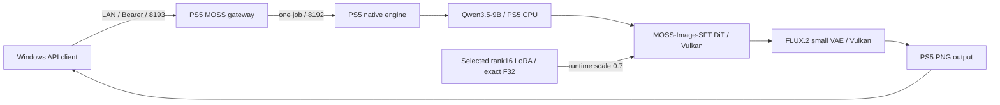

# PS5 AI MOSS Image

MOSS-Image-SFTとユーザー指定LoRAをPS5本体で推論するネイティブアプリと、LAN用のOpenAI Images互換APIを開発しています。

**2026-10-20、MOSS-Image-SFT＋[選択LoRA](docs/moss-requested-lora.md)で、PS5 CPUのtext encoding・Vulkan DiT/VAE・WindowsからOpenAI互換API経由のPNG取得を確認し、性能改善3点の比較も完了しました。** 現在はFP32の提出単位調整＋限定fusionを実験profileとして残しています。FP16候補は起動数値ゲートで拒否され、生成していません。

| PS5生成時間、50steps | 計測入りFP32基準 | 提出調整＋限定fusion FP32 |
|---|---:|---:|
| 256×256初回、model読込込み | 153.972336秒 | 152.631656秒 |
| 同processの256後、1024×1024初回 | 1219.096190秒 | 1214.444805秒 |

各構成1回の比較で差は約0.87%／0.38%と小さく、大幅高速化は未達、安定した改善率の証明ではありません。各sizeのPNGは全バイト・RGBが完全一致しました。[実装・実測・FP16拒否の根拠](docs/moss-performance-optimization-20261020.md)を参照してください。

**Privateの実験版です。** 同prompt・seed20261020・LoRA0.7・CFG3・flow shift5・Eulerを固定し、各要求1POST、自動再送0で測定しました。実験profileは最大4試行で失敗も消費し、production admission0を維持します。10GiB poolで12GiB目標は未達、平均／分散・長時間連続運用・最小必要stepsは未検証です。比較後は両APIの通常終了、両PID不在、独立idleを確認して停止しています。

前回の1024単独cold/warmは初回読込込み1242.706350秒／同process2回目1177.725365秒でした。今回は256後の新shape1024なので、前回のwarmと直接同条件ではありません。OS disk cacheはflushしておらず、warmでもweight転送ゼロとは扱いません。[前回の実測範囲](docs/moss-1024-cold-warm-20261020.md)は履歴として保持します。

以前の256×256比較では4stepsの色縞が50stepsで解消しました。通常のAPI既定値は元から50で、4は初回smoke限定値です。[256×256の原因比較](docs/moss-native-small-trial-20261019.md)を履歴として保持します。

Windowsは開発・APIクライアントに使います。モデル推論をPCやクラウドへ移しません。WAI・Anima・MOSSは同時起動しません。

| 項目 | 現在の構成 |
|---|---|
| アプリ / Title ID | PS5 AI MOSS Image / PPSA99190（登録・実機起動確認） |
| 配置 | `/data/ai/native-moss-image-sft/PPSA99190` |
| Native / OpenAI gateway | 8192 / 8193、model `moss-image-sft` |
| モデル | SFT Q4_K + Qwen3.5-9B Q4_K_M + FLUX.2 small VAE + 外部tokenizer + 選定rank16 LoRA |
| Direct予約目標 / 実測trial | **12GiBは未達** / 承認済み実験10GiB、1GiB regions |
| 推論予算 | production例11.5GiB / 実験9.5GiB、pool外working reserve 1GiB |
| 最新の実測 | FP32提出調整＋限定fusion、256初回152.631656秒／同processの256後1024初回1214.444805秒。50steps、Euler、CFG3、shift5、LoRA0.7 |

12GiBはGPU専用の独立VRAMではなく、CPU/GPU共有のDirect領域の目標です。今回のnative contextの総量報告は11.4375GiBで、pool12GiB + reserve1GiBの容量判定を通りません。仮想アドレスの区切り変更では物理メモリ枠は増えません。今回の1024画像2枚の成功から、12GiB確保や他条件・長時間運用の安全性は推定しません。APIの`peak_gpu_bytes`もCPU text weightsを含むowned poolピークの合計で、純粋なVRAM実使用量ではありません。

Qwenのembeddingは実GGUFヘッダーで545.625MiBと確認しました。旧512MiB単体割当上限を超えるため、MOSS側のregionを1GiBへ拡張しています。今回の実機ではCPU text encoding、BF16を含む限定GPU読み戻しとDiT/VAE完了を確認しましたが、全演算の数値正しさと画質を証明するものではありません。SDXL用LoRA、ControlNet、IP-Adapter、img2img/inpaintingはMOSSへ流用せず、APIで拒否します。

- [現在の検証範囲](docs/status.md)
- [固定モデル・ハッシュ・メモリ・ライセンス](docs/moss-models.md)
- [指定LoRAの実ヘッダー・メモリ・互換対応](docs/moss-requested-lora.md)
- [APIとOpenAPI](docs/api.md)
- [設定例](config/moss-native.json.example)
- [ビルド](docs/build.md) / [配置計画](docs/deployment.md)

[OpenMOSS公式](https://github.com/OpenMOSS/MOSS-Image)と[SD.cppのMOSS対応](https://github.com/leejet/stable-diffusion.cpp/blob/b13a48219d5cdf408edcb93da6cd69b612ed03d3/docs/moss_image.md)を参照しています。実装は既存PS5向けSD.cppへMOSS対応commitを範囲限定で移植し、選定LoRAを含むcore全75オブジェクトを新規再構築しました。最新upstream全体への置換ではありません。

このリポジトリは[PS5 AI WAI](https://github.com/akiba-tokyo-jp/PS5-AI-WAI)とPS5 AI Animaの履歴を継承します。`docs/`に残るWAI/Animaの成功画像・ベンチマーク・検証結果はMOSSの結果ではありません。[Anima元README](ANIMA-BASE-README.md)、[WAI元README](WAI-BASE-README.md)、著作権・[第三者通知](THIRD_PARTY_NOTICES.md)を保持します。ホームアイコンは継承した仮アセットです。

重み・token・個人ログ・ビルド済みバイナリはGitへ含めません。正常な検証出力PNGだけを同梱し、今回の同一画像は1枚だけ保存しています。アプリのGPL等と各モデルのApache-2.0条件は別に扱います。公開の別指示まではprivateを維持します。
