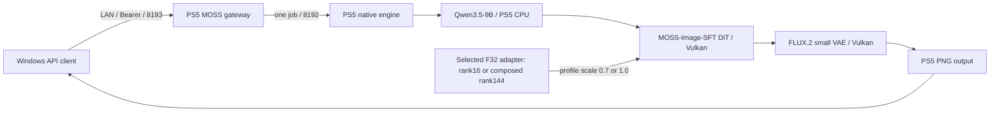

# PS5 AI MOSS Image

MOSS-Image-SFTとユーザー指定LoRAをPS5本体で推論するネイティブアプリと、LAN用のOpenAI Images互換APIを開発しています。

**Turbo4専用trialでは、256×256の初回読込込み71.564874秒、同processの256後1024×1024初回51.133430秒で生成し、OpenAI互換APIからPNGを取得しました。** 4-step Euler／CFG1とNSFW0.7＋Turbo1.0のrank144合成adapterによる別条件です。50-step基準1023.859406秒との1024の単回差は約95.01%ですが、同画質・同一PNGの比較ではありません。[Turbo4実測・メモリ・確認範囲](docs/moss-turbo4-results-20261020.md)、[固定weightsの再現手順](docs/moss-turbo4-reproduction.md)。

**2026-10-20の追加実機試験では、同promptの256後1024初回が、50-step基準キャッシュ版1023.9秒に対し、30-step res_multistep/CFG4で617.4秒、50-step Euler/CFG3＋Spectrumで617.9秒でした。** 各条件1回のguarded trialで、前者はsampling条件変更、後者は20回のlatent予測を含み、同画質・同一PNG・通常既定値の比較ではありません。FP16データ＋FP32累積、PS5内CPU text encodingとVulkan DiT/VAE、OpenAI互換APIからのPNG取得を維持しています。[実測条件とメモリの範囲](docs/moss-sampler-spectrum-memory-20261020.md)。

| PS5生成時間、50steps | 計測入りFP32基準 | 提出調整＋限定fusion FP32 | FP16データ＋FP32累積 |
|---|---:|---:|---:|
| 256×256初回、model読込込み | 153.972336秒 | 152.631656秒 | **145.839851秒** |
| 同processの256後、1024×1024初回 | 1219.096190秒 | 1214.444805秒 | **1064.248911秒** |

FP32基準比で256は5.28%、1024は12.70%短縮しました。各構成1回の比較で、反復して安定する改善率は未確定です。新しい版の両PNGを開いて画質、LoRA適用、GPU完了と非有限値0を確認しました。nativeとOpenAI互換APIで取得したPNGは一致します。FP32版とのpixel一致は主張しません。[実装と実測の詳細](docs/moss-mixed-precision-20261020.md)、[以前の提出/fusion・FP16拒否の比較](docs/moss-performance-optimization-20261020.md)を参照してください。

追加最適化では二つのkernel候補に全体短縮が見られず、基準GPU経路へ戻しました。同promptの解像度変更でCPU text encodingを再利用するMOSS限定キャッシュ版は、256初回146.016289秒、同processの256後1024初回**1023.859406秒**でした。上表の混合精度基準1064.248911秒に対し40.389505秒（3.7951%）短縮し、両PNGは対応する基準と全バイト一致・目視正常でした。各1回の比較で、新promptやDiT自体の高速化を示すものではありません。完全な現行ログで256のcache hit 0件／1024の2件を確認し、native・gatewayの通常終了後、別の新規observerでGPU titleなし・既存サービス継続を確認しました。[追加調査と検証範囲](docs/moss-additional-optimization-20261020.md)。

別の50-step読み込み試験では、GPU重み転送用host stagingを**workerあたり最大8MiB**へ制限し、必要量まで増やす版を確認しました。256初回は146.016289→145.680067秒でほぼ同等、PNGは全バイト一致でした。初回生成のheap mapping高水位とRSS高水位は低下しましたが、物理RAM・VRAM削減量の証明ではありません。[読み込みとメモリの実測範囲](docs/moss-bounded-weight-upload-20261020.md)。

**Privateの実験版です。** 上記50-step基準は同prompt・seed20261020・LoRA0.7・CFG3・flow shift5・Eulerを固定し、各要求1POST、自動再送0で測定しました。実験profileは最大4試行で失敗も消費し、production admission0を維持します。10GiB poolで12GiB目標は未達、平均／分散・長時間連続運用・最小必要stepsは未検証です。速度改善の余地をすべて調べ終えたものではありません。

前回の1024単独cold/warmは初回読込込み1242.706350秒／同process2回目1177.725365秒でした。今回は256後の新shape1024なので、前回のwarmと直接同条件ではありません。OS disk cacheはflushしておらず、warmでもweight転送ゼロとは扱いません。[前回の実測範囲](docs/moss-1024-cold-warm-20261020.md)は履歴として保持します。

基準rank16 LoRAだけで行った以前の256×256比較では4stepsの色縞が50stepsで解消しました。今回のTurbo4は追加のdistilled adapterと専用sigmasを使う別profileで、通常の50-step API既定値は変更していません。[256×256の原因比較](docs/moss-native-small-trial-20261019.md)を履歴として保持します。

Windowsは開発・APIクライアントに使います。モデル推論をPCやクラウドへ移しません。WAI・Anima・MOSSは同時起動しません。

| 項目 | 現在の構成 |
|---|---|
| アプリ / Title ID | PS5 AI MOSS Image / PPSA99190（登録・実機起動確認） |
| 配置 | `/data/ai/native-moss-image-sft/PPSA99190` |
| Native / OpenAI gateway | 8192 / 8193、model `moss-image-sft` |
| モデル | SFT Q4_K + Qwen3.5-9B Q4_K_M + FLUX.2 small VAE + 外部tokenizer + 選定rank16 LoRA（Turbo4専用trialは合成rank144） |
| Direct予約目標 / 実測trial | **12GiBは未達** / 承認済み実験10GiB、1GiB regions |
| 推論予算 | production例11.5GiB / 実験9.5GiB、pool外working reserve 1GiB |
| 基準キャッシュ版の単回実測 | キャッシュ版の256初回146.016289秒／同processの256後1024初回1023.859406秒。基準1064.248911秒比3.7951%短縮、両サイズ基準と同一PNG。50steps、Euler、CFG3、shift5、LoRA0.7 |

12GiBはGPU専用の独立VRAMではなく、CPU/GPU共有のDirect領域の目標です。今回のnative contextの総量報告は11.4375GiBで、pool12GiB + reserve1GiBの容量判定を通りません。仮想アドレスの区切り変更では物理メモリ枠は増えません。今回までの生成成功から、12GiB確保や他条件・長時間運用の安全性は推定しません。APIの`peak_gpu_bytes`もCPU text weightsを含む共有Direct poolとdriver arenaのピークから得た上界で、純粋なVRAM実使用量ではありません。

Qwenのembeddingは実GGUFヘッダーで545.625MiBと確認しました。旧512MiB単体割当上限を超えるため、MOSS側のregionを1GiBへ拡張しています。今回の実機ではCPU text encoding、BF16を含む限定GPU読み戻しとDiT/VAE完了を確認しましたが、全演算の数値正しさと画質を証明するものではありません。SDXL用LoRA、ControlNet、IP-Adapter、img2img/inpaintingはMOSSへ流用せず、APIで拒否します。

- [現在の検証範囲](docs/status.md)
- [固定モデル・ハッシュ・メモリ・ライセンス](docs/moss-models.md)
- [指定LoRAの実ヘッダー・メモリ・互換対応](docs/moss-requested-lora.md)
- [APIとOpenAPI](docs/api.md)
- [設定例](config/moss-native.json.example)
- [ビルド](docs/build.md) / [配置計画](docs/deployment.md)

[OpenMOSS公式](https://github.com/OpenMOSS/MOSS-Image)と[SD.cppのMOSS対応](https://github.com/leejet/stable-diffusion.cpp/blob/b13a48219d5cdf408edcb93da6cd69b612ed03d3/docs/moss_image.md)を参照しています。実装は既存PS5向けSD.cppへMOSS対応commitを範囲限定で移植し、選定LoRAを含むcore全75オブジェクトを新規再構築しました。最新upstream全体への置換ではありません。

このリポジトリは[PS5 AI WAI](https://github.com/akiba-tokyo-jp/PS5-AI-WAI)とPS5 AI Animaの履歴を継承します。`docs/`に残るWAI/Animaの成功画像・ベンチマーク・検証結果はMOSSの結果ではありません。[Anima元README](ANIMA-BASE-README.md)、[WAI元README](WAI-BASE-README.md)、著作権・[第三者通知](THIRD_PARTY_NOTICES.md)を保持します。ホームアイコンは継承した仮アセットです。

重み・token・個人ログ・ビルド済みバイナリはGitへ含めません。正常な検証出力PNGだけを同梱し、今回の同一画像は1枚だけ保存しています。アプリのGPL等と各モデルのApache-2.0条件は別に扱います。公開の別指示まではprivateを維持します。
