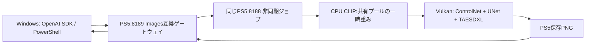
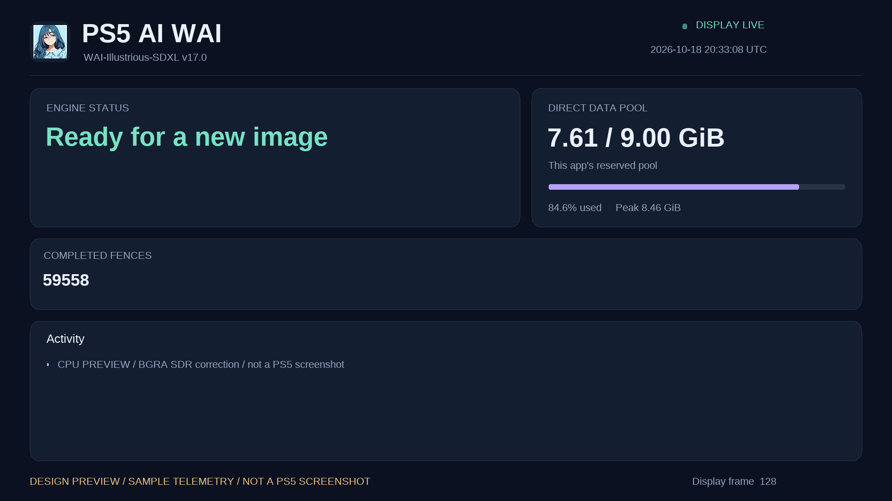
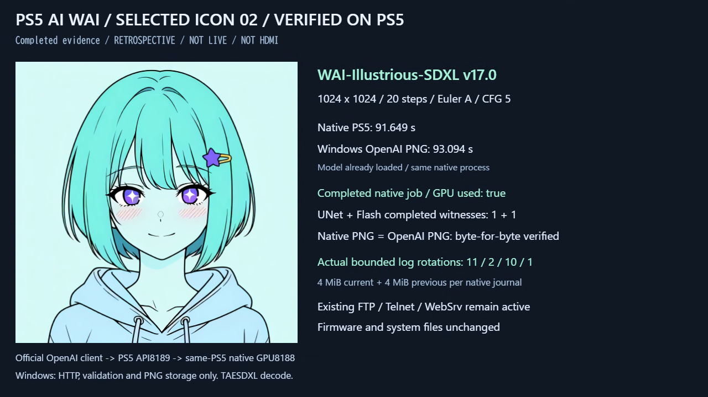
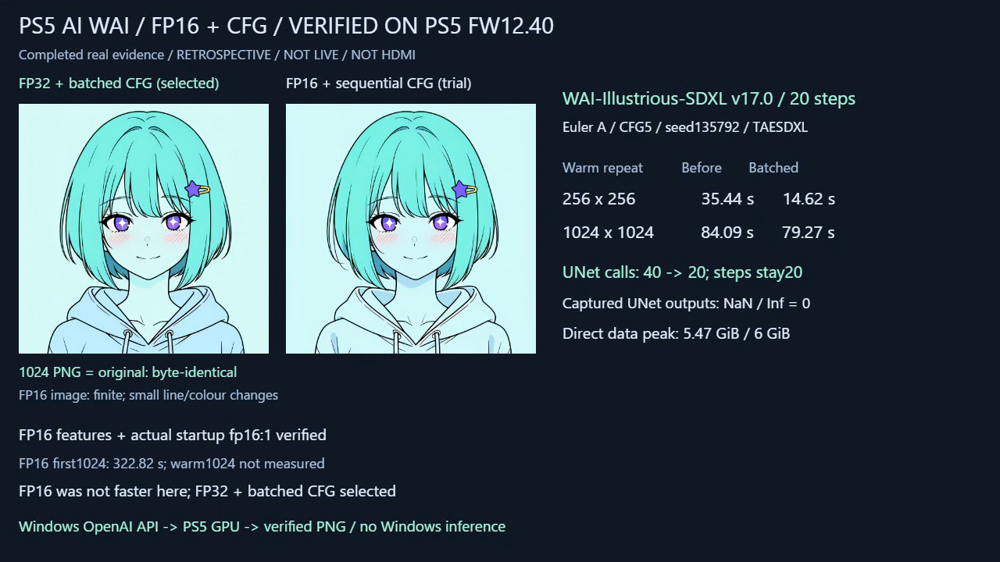

# PS5 AI WAI

2026-10-19：**CLIPの重複計算削減・UNet共通計算の再利用・ControlNetのCFGバッチ化・メモリ割当を反映しました。** 最終構成はDirect 9422MiB（約9.201GiB）、CPU CLIPの重みグループは16MiB目安です。OpenPose＋漫画LoRA1／20stepsの256初回は124.567→115.815秒。同じプロセスで256→1024の切替132.952秒、同じ1024の繰返し117.600秒、基準PNGと一致しました。1024同士のキャッシュ条件は異なるため速度倍率は算出しません。[比較・メモリ・検証範囲](docs/optimization-20261019.md)・[成功動画12秒](docs/media/optimization-openpose1024.mp4)。

2026-10-19：**UNetの工程別計測とログ同期を修正しました。** 同じOpenPose1024初回は194.54→184.03秒、PNG完全一致。pool/startupのfsync合計は12.73→0.33秒でした。各1枚の観測です。[工程別実測・条件・制約](docs/unet-profiling.md)を参照してください。 [実API検証の成功動画12秒](docs/media/controlnet-openpose1024-logsync.mp4)。

BGRAの描画とVideoOut形式を揃え、赤紫になる表示色を修正して実機へ反映しました。TVの配色はユーザーが「色は直りました」と確認済みです。ホームは画像ファイルが更新済みでも旧キャッシュ表示が続いており、表示更新成功とは扱いません。

2026-10-18：**Canny / OpenPose ControlNetの256・1024生成とOpenAI互換APIからのPNG取得をPS5実機で確認しました。** Direct9GiB・512MiB単位、CPU CLIP一時重みの共有プール利用に対応しています。ホーム用・状態画面内の画像ファイルをユーザー添付キャラクターへ更新しました。ホームの表示は旧アイコンのままです。
[実測値・制約・モデル配置](docs/controlnet.md)・[API仕様](docs/api.md)。

| 1024×1024 /20steps /漫画LoRA1 | PS5内生成 |
|---|---:|
| Canny | 162.56秒 |
| OpenPose | 329.68秒 |

この表は2026-10-18の機能検証各1枚です。OpenPose遅延の一部はログ同期で説明できましたが、GPU演算・内部待ちの分離と初回の断片化対策は残っています。最新の同条件比較は上の工程別記録を参照してください。


[Canny成功動画12秒](docs/media/controlnet-canny1024.mp4)・[OpenPose成功動画12秒](docs/media/controlnet-openpose1024.mp4)。実Windows操作録画の完了部分で、12秒が生成時間という意味ではありません。



従来の漫画LoRA256検証は[過去の記録](docs/manga.md)を参照してください。現行版も漫画LoRA強度1を既定とし、自動monochromeは既定で無効です。

状態画面を濃紺とミントのカード表示へ更新しました。滑らかな文字・進捗・取得できるメモリ値・ログをCPUで描画します。
[画面と実機検証](docs/dashboard.md)・[16秒の成功記録](docs/media/dashboard-success.mp4)を参照してください。取得できない使用率や温度は表示しません。

2026-10-18：通常／デバッグのログを分離し、主要な継続ログを合計64MiBへ制限しました。
WAI768×1024・20stepsは初回92.47秒、読み込み済み57.06秒で同一PNGを確認。
続く別プロンプト8枚はPS5内72.34～72.42秒。条件・cache差・実機証拠は[ログと速度改善](docs/logging.md)を参照。
その後も生成を休止せず、連続6枚を70.62～70.69秒で確認しました。4枚目以降の遅延はこの6枚では再発していません。

<p align="center">
  
</p>

<p align="center"><strong>PS5のGPUでWAIを生成。WindowsからHTTPでPNGを取得。</strong></p>

脱獄済みPS5のネイティブアプリとして **WAI-Illustrious-SDXL v17.0** を実行する開発者向けプロジェクトです。
`stable-diffusion.cpp / GGML → Vulkan → PS5向けRADV / AGC` を接続し、画像生成APIとテレビ上の状態表示を実装しました。
Windowsはビルド・転送・APIクライアントを担当します。推論はPS5本体で実行します。

**FW 12.40でGPU生成とWindowsからのPNG取得を確認済みです。** 漫画LoRAとControlNetを含む1024×1024まで確認しました。
実験的な移植です。他のFW、本体、起動環境での動作は未検証です。




上図は同じ描画コードをWindowsで実行した仮データ・添付キャラクターのプレビューです。PS5のHDMIスクリーンショットではありません。
実機では取得できる項目だけを表示するため、カード数や数値は異なります。

## 実際に生成した画像

<p align="center">
  
</p>

WAI v17.0 / 1024×1024 / Euler ancestral / 20 steps / CFG 5 / seed 135792。
CPU CLIP、GPU UNet・Flash Attention、TAESDXLで復号しました。フルVAEと同一の画質という意味ではありません。

[](docs/media/verified-results.mp4)

**[25秒の成功結果動画を見る](docs/media/verified-results.mp4)** — 実PNGと実測ログを表示したWindows画面の振り返り録画です。
ライブ生成中の映像・PS5のHDMIキャプチャではありません。GitHubでプレビューできない場合は動画ページからダウンロードできます。

## LoRA導入前の性能改善

20 stepsのCFGをbatch2にまとめ、UNet呼び出しを40回から20回へ減らしました。採用設定は**FP32演算 + batched CFG**です。

| 読み込み済み・同条件の繰り返し | 従来FP32 | CFGバッチ化後 |
|---|---:|---:|
| 256×256 / 20 steps | 35.44秒 | **14.62秒** |
| 1024×1024 / 20 steps | 84.09秒 | **79.27秒** |

256のPNGは元版と完全一致。1024も取得・目視・NaN/Inf検査を完了しました。6GiBのDirect枠を維持しています。
FP16は物理機能と`fp16: 1`、実GPU読み戻し、WAI1024生成まで確認しましたが、この構成では遅く、既定には採用していません。
初回・読み込み済みを分けた値と限界は[FP16/CFG比較](docs/precision.md)、[短い検証動画](docs/media/precision-cfg-verified.mp4)をご覧ください。

[](docs/media/precision-cfg-verified.mp4)

## 前版の確認記録


2026-10-18 JST、同じネイティブプロセスで実施しました。時間はモデル読込・推論・復号を含むアプリ側の時間と、Windowsが応答を受け取るまでの時間です。

| 画像サイズ / steps | モデルの状態 | PS5生成 | WindowsでPNG取得まで |
|---|---|---:|---:|
| 256×256 / 8 | 初回読込を含む | 43.23秒 | 44.52秒 |
| 1024×1024 / 20 | 読込済み | **91.65秒** | **93.09秒** |

過去の同プロセス・同条件比較では1024×1024 / 8 stepsが初回65.03秒、読込済み34.12秒でした。
別の生成設定・ソフトウェア版での記録なので、上の20 stepsと直接の速度比は求めていません。
他PCとの完全同条件の比較は未実施です。

- 起動時に **64MiBのGPU Compute結果をCPUへ読み戻して照合**。予約した6GiB全域を検査したものではありません。
- 画像生成中に完了済みUNet重み演算とFlash Attentionをサンプル観測。1024のカウンター差分はdispatch 138,826、submit 29,518、fence完了29,518です。GPU使用率の測定値ではありません。
- Directデータプール **6GiB**、1024生成時の所有データプールピーク約5.06GiB。プロセスpeak RSS約8.38GiBは共有マッピングを含み得るため合算しません。
- ネイティブAPIのPNG、OpenAI応答、PowerShellで取得したPNGがSHA256で一致しました。
- 生成後は両APIがreadyに復帰。既存FTP・Telnet・WebSrvなどを維持し、検証のためのFW更新・システム領域への書き込みはありません。

詳細な数値と限界は **[検証記録](docs/verification.md)**、機械可読値は [verification.json](docs/verification.json) にあります。
この公開版はソースと依存ライブラリを用いた再ビルドを対象とします。依存ライブラリ一式をゼロから再現する手順と初回のアプリ登録は、まだ汎用化されていません。

## Windowsから使う

PS5側のネイティブアプリ・APIが既に起動している環境で使用します。
OpenAI互換アダプターはPS5の別プロセス、ポート8189です。既存WebSrvの8080とネイティブ非同期APIの8188を維持します。

```powershell
# PS5のプライベートIPv4と、別途作成したトークンファイルを指定
.\scripts\Invoke-WaiOpenAI.ps1 `
  -BaseUrl 'http://192.168.1.100:8189/v1' `
  -TokenFile 'D:\ps5-private\api-token' `
  -Prompt 'masterpiece, best quality, cute adult manga girl, gentle smile' `
  -Width 1024 -Height 1024 -Steps 20 -Seed 135792 `
  -OutputDirectory 'D:\PS5-AI\output'
```

モデル一覧だけを確認する場合は `-ListModels` を付けます。推論は発生しません。

```python
import base64
from pathlib import Path
from openai import OpenAI, DefaultHttpxClient

client = OpenAI(
    base_url="http://192.168.1.100:8189/v1",
    api_key=Path("D:/ps5-private/api-token").read_text().strip(),
    max_retries=0,  # タイムアウト後の重複生成を避ける
    timeout=1800,
    http_client=DefaultHttpxClient(trust_env=False),
)
image = client.images.generate(
    model="wai-illustrious-sdxl-v17.0",
    prompt="cute adult manga girl, front view, gentle smile",
    size="1024x1024", n=1, response_format="b64_json",
    extra_body={"steps": 20, "cfg_scale": 5, "seed": 135792, "sampler": "euler_a"},
)
Path("wai.png").write_bytes(base64.b64decode(image.data[0].b64_json, validate=True))
client.close()
```

対応範囲は **OpenAI Images APIの生成機能の一部**です。PNG・1枚・非ストリーミングに対応します。
img2img/IP-Adapterの参照入力とimages/editsは実験機能です。mask/inpainting、複数枚、透過、JPEG/WebP出力、ComfyUIやA1111のAPIは未対応です。
詳しくは [API仕様](docs/api.md) と [OpenAPI 3.1](docs/openapi.json) を参照してください。

## 実装とビルド

| 場所 | 内容 |
|---|---|
| [`native/app`](native/app) | ネイティブ起動、GPUゲート、Directプール、エンジン接続、非同期API、上限付きログ |
| [`native/runtime`](native/runtime) | Directスレッドスタック、C++割当、TLS終了処理 |
| [`native/ui`](native/ui) | VideoOutの状態画面。時計・heartbeat・取得できたメモリ値・ログを表示 |
| [`native/gateway`](native/gateway) | 同じPS5の8188へ転送するCPU専用OpenAIアダプター |
| [`native/link`](native/link) | ネイティブCRT、公開APIスタブ、リンカー設定、互換関数 |
| [`patches`](patches) | SD/GGML・RADVの対応ソースと変更点 |
| [`tools`](tools) / [`build-profiles`](build-profiles) | パスを設定できるビルドと依存ライブラリ照合 |
| [`scripts`](scripts) / [`tests`](tests) | PowerShellクライアントと推論を行わないホスト試験 |

**[ビルド手順・再現性の範囲](docs/build.md)** → **[配置と運用](docs/deployment.md)** → **[モデルとライセンス](docs/models.md)**

主要な継続ログは合計64MiB上限・各2世代で保持し、高頻度ログと大容量データ領域を分けます。
致命的エラー時はAPIへfailed/degradedを通知し、新規生成を503で拒否します。
不明な状態のGPUメモリを自動解放したり、生成POSTを自動再送したりする実装はありません。

新しい画面の表示完了とheartbeat更新は実機APIで確認済みです。新デザインのテレビ上の配色・文字切れと、ホーム画面のアイコンキャッシュ更新は別途目視確認が必要です。
取得できない使用率・温度などの項目は表示しません。

## クレジットとライセンス

本プロジェクトは既存のオープンソース実装を移植・接続したものです。画像モデルやVulkanドライバーを独自開発したという意味での「オリジナル」ではありません。

- [stable-diffusion.cpp](https://github.com/leejet/stable-diffusion.cpp) / GGML — 画像推論、MIT。
- [PS5_Vulkan](https://github.com/mihawk-99/PS5_Vulkan) / [PS5_Mesa](https://github.com/mihawk-99/PS5_Mesa) — PS5向けGPU実装、ネイティブツール、RADV。各ソースのGPL / MIT等を維持。
- [PS5 Payload SDK](https://github.com/ps5-payload-dev/sdk) / [PS5_PayloadSDK fork](https://github.com/mihawk-99/PS5_PayloadSDK) — 公開SDKとプラットフォーム実装。
- [cobanov/PS5LM](https://github.com/cobanov/PS5LM)、[mansanitizer/psllama](https://github.com/mansanitizer/psllama) — 実績のあるネイティブ起動・メモリ・画面処理の比較、参考。
- [ps5-payload-dev/websrv](https://github.com/ps5-payload-dev/websrv) — 既存のデプロイ・起動経路の参考。
- [WAI0731 / WAI-Illustrious-SDXL](https://civitai.com/models/827184?modelVersionId=2883731) / [TAESD](https://github.com/madebyollin/taesd) — モデルは別途取得。重みは本リポジトリに含めません。

統合アプリのライセンスは **GPL-3.0-or-later**。MIT等のファイル単位の表記と著作権表示を保持します。
モデルの利用条件はコードのライセンスと別です。[第三者ライセンス](THIRD_PARTY_NOTICES.md)を確認してください。
Sony公式SDK、FW、鍵、Jailbreak exploit、認証トークン、個人用ログは配布しません。
