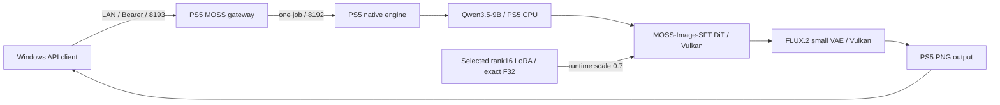

# PS5 AI MOSS Image

MOSS-Image-SFTとユーザー指定LoRAをPS5本体で推論するネイティブアプリと、LAN用のOpenAI Images互換APIを開発しています。

**2026-10-19、MOSS-Image-SFT＋[選択LoRA](docs/moss-requested-lora.md)で、PS5のCPU text encoding・Vulkan DiT/VAE・WindowsからのOpenAI互換API経由PNG取得まで、256×256・50stepsの正常な画像を確認しました。初回モデル読込を含む生成時間は148.133782秒です。LoRAは504/504テンソルが実適用されました。** [実機結果と検証範囲](docs/moss-native-small-trial-20261019.md)を参照してください。

**Privateの実験版です。** 初回4stepsで生じた強い色縞は、同一SELF・同一条件でstepsだけ50へ増やした比較で解消しました。この条件のsampling不足が原因と判断しています。通常のAPI既定値は元から50で、4は初回smoke試験の限定値でした。実測は人が許可した10GiB poolの専用trialで、12GiB目標は未達です。productionのcompile-time runtime admissionは0を維持します。warm生成・高解像度・連続運用・最小必要stepsは未検証です。試験後はnative/gatewayの正常終了と独立したidle確認を完了しました。

Windowsは開発・APIクライアントに使います。モデル推論をPCやクラウドへ移しません。WAI・Anima・MOSSは同時起動しません。

| 項目 | 現在の構成 |
|---|---|
| アプリ / Title ID | PS5 AI MOSS Image / PPSA99190（登録・実機起動確認） |
| 配置 | `/data/ai/native-moss-image-sft/PPSA99190` |
| Native / OpenAI gateway | 8192 / 8193、model `moss-image-sft` |
| モデル | SFT Q4_K + Qwen3.5-9B Q4_K_M + FLUX.2 small VAE + 外部tokenizer + 選定rank16 LoRA |
| Direct予約目標 / 実測trial | **12GiBは未達** / 承認済み実験10GiB、1GiB regions |
| 推論予算 | production例11.5GiB / 実験9.5GiB、pool外working reserve 1GiB |
| 実測の品質比較 | 256×256、Euler、CFG3、flow shift5、LoRA0.7。4steps 68.525607秒 → 50steps 148.133782秒、各fresh process |

12GiBはGPU専用の独立VRAMではなく、CPU/GPU共有のDirect領域の目標です。今回のnative contextの総量報告は11.4375GiBで、pool12GiB + reserve1GiBの容量判定を通りません。仮想アドレスの区切り変更では物理メモリ枠は増えません。10GiBでの小画像1枚の成功から、12GiB確保や大画像の安全性は推定しません。APIの`peak_gpu_bytes`もCPU text weightsを含むowned poolピークの合計で、純粋なVRAM実使用量ではありません。

Qwenのembeddingは実GGUFヘッダーで545.625MiBと確認しました。旧512MiB単体割当上限を超えるため、MOSS側のregionを1GiBへ拡張しています。今回の実機ではCPU text encoding、BF16を含む限定GPU読み戻しとDiT/VAE完了を確認しましたが、全演算の数値正しさと画質を証明するものではありません。SDXL用LoRA、ControlNet、IP-Adapter、img2img/inpaintingはMOSSへ流用せず、APIで拒否します。

- [現在の検証範囲](docs/status.md)
- [固定モデル・ハッシュ・メモリ・ライセンス](docs/moss-models.md)
- [指定LoRAの実ヘッダー・メモリ・互換対応](docs/moss-requested-lora.md)
- [APIとOpenAPI](docs/api.md)
- [設定例](config/moss-native.json.example)
- [ビルド](docs/build.md) / [配置計画](docs/deployment.md)

[OpenMOSS公式](https://github.com/OpenMOSS/MOSS-Image)と[SD.cppのMOSS対応](https://github.com/leejet/stable-diffusion.cpp/blob/b13a48219d5cdf408edcb93da6cd69b612ed03d3/docs/moss_image.md)を参照しています。実装は既存PS5向けSD.cppへMOSS対応commitを範囲限定で移植し、選定LoRAを含むcore全75オブジェクトを新規再構築しました。最新upstream全体への置換ではありません。

このリポジトリは[PS5 AI WAI](https://github.com/akiba-tokyo-jp/PS5-AI-WAI)とPS5 AI Animaの履歴を継承します。`docs/`に残るWAI/Animaの成功画像・ベンチマーク・検証結果はMOSSの結果ではありません。[Anima元README](ANIMA-BASE-README.md)、[WAI元README](WAI-BASE-README.md)、著作権・[第三者通知](THIRD_PARTY_NOTICES.md)を保持します。ホームアイコンは継承した仮アセットです。

重み・token・個人ログ・ビルド済みバイナリはGitへ含めません。上の小さな正常出力PNGだけを検証画像として同梱しています。アプリのGPL等と各モデルのApache-2.0条件は別に扱います。公開の別指示まではprivateを維持します。
