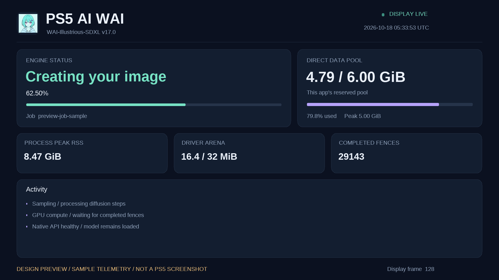
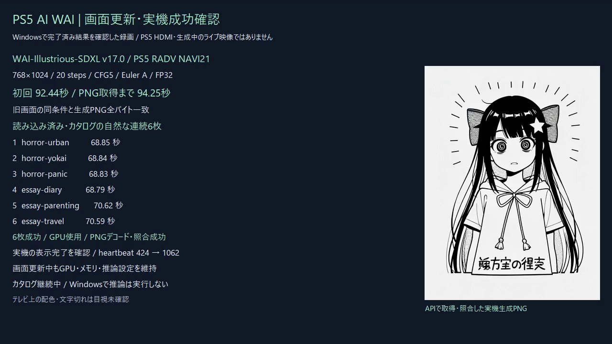

# CPUで描画する状態画面

濃紺の背景とミント・ラベンダーのアクセント、滑らかな文字、状態・メモリ・ログのカード表示です。
既存のWAIアイコンを使用します。文字とカードはCPUで描画し、表示用Directバッファ32MiBと約1秒の更新間隔を維持しました。
Vulkan描画コンテキストや外部GUIライブラリは追加していません。



これは同じ描画コードをWindowsで実行した仮データのプレビューで、PS5のHDMI映像ではありません。
PS5実機では表示完了とheartbeatの更新をAPIで検証しています。テレビ上の配色や文字切れの目視確認は別に扱います。

## 表示する情報

- アプリ名、モデル名、PS5のUTC時計、表示ループのheartbeat。
- 有効な取得値がある場合の処理状態・ジョブ・進捗。
- アプリが予約したDirect data poolの使用量・容量・ピーク。全VRAMの使用量ではありません。
- 取得元が明確なメモリ値と完了済みfenceカウンター。
- フィルターを通過した直近ログ。認証情報のラベルを含む行は表示しません。

値を取得できない項目はラベルごと省略します。現在のネイティブ発行元はCPU/GPU使用率・温度・現在RSSを提供しないため、表示しません。
プレビューのRSSやdriver arenaは表示能力を確認するためのサンプル値です。
3秒より古いサンプルは状態・メトリクスを無効化し、表示heartbeatを推論進捗として扱いません。

## APIと互換性

認証付きネイティブ`GET /health`は、取得できた場合に`tv_display`を返します。

```json
{"tv_display":{"ready":true,"heartbeat":128,"last_presented_frame":128,"fault":false,"stopped":false}}
```

数値は応答形式の例です。`ready`と`last_presented_frame`はVideoOutの正の表示完了確認に基づきます。
mutexが一時的に使用中なら`tv_display`はnullで、API側は待ちません。
CPUゲートウェイは上流healthの追加メタデータを深さ・容量制限付きで読み飛ばします。
利用者からの生成リクエストと上流ジョブのJSONは従来の厳密な平坦形式を維持します。

`gpu_verified`は画像生成でUNetのGPU計算が完了したことを表すため、起動後の最初の画像より前はfalseです。
表示用GPU gateの完了、モデル読み込み済み、画像のGPU計算完了はそれぞれ区別してください。

## 検証

表示データの既存10条件、フレーム領域ガード、healthの3状態、上流メタデータparserの10条件、既存API試験30項目を確認しました。
ホスト試験はメタデータと描画だけで、画像推論を実行しません。
新しい実機アプリでも同条件の768×1024・20stepsを生成し、初回92.443825秒、Windows取得94.25秒でした。
旧画面の初回92.473289秒と比較でき、生成PNGは全バイト一致しました。

PNG SHA256：`763b3eca54fda750cbc03081570dafb0d3127824abc0a834c70ae493175ba8cd`。
推論エンジン、GPUドライバー、FP32、6GiBのDirect data pool、モデル、samplerは維持しました。
実機で実行したSELF SHA256：`be1067a7520dce661129a2a1cab8c85fd92bd01be17d1d82b91917199679fac6`。
公開ソースの別ビルドは実機実行したものと区別します。

フォントは静的なOFL-1.1のビットマップで、ライセンスは[font license](../licenses/WAI-Dashboard-Glyphs-OFL.txt)に保持しています。

## 継続生成の実測

更新後も元のカタログを継続し、自然な連続6枚を観測しました。追加のwarm生成POSTはありません。

| カタログID | PS5内生成時間 | Windows PNG取得まで |
|---|---:|---:|
| horror-urban | 68.854秒 | 70.31秒 |
| horror-yokai | 68.845秒 | 70.55秒 |
| horror-panic | 68.835秒 | 70.72秒 |
| essay-diary | 68.794秒 | 70.09秒 |
| essay-parenting | 70.620秒 | 72.26秒 |
| essay-travel | 70.590秒 | 71.95秒 |

6枚ともGPU使用・PNG全デコード・OpenAI互換保存分とネイティブGETの全バイト一致を確認。
実機の表示heartbeatは424→1062へ進み、正のVideoOut表示完了を観測し、faultは0でした。
同一native/gatewayプロセスを維持しました。温度・使用率は取得しておらず、全カタログ完了やメモリリークなしを示す試験ではありません。
機械可読値：[dashboard-verification.json](dashboard-verification.json)。

再現用ホスト確認：`python tests/dashboard.py --config .local/build.json --out <private-build-dir>`。
画面フレームのガードと上流health追加メタデータの10条件を確認します。ホストで画像推論は行いません。

## Windows成功記録

[](media/dashboard-success.mp4)

[16秒のWindows録画](media/dashboard-success.mp4)。完了済みの実機結果を表示した画面で、生成中のライブ映像やPS5 HDMI録画ではありません。
H264・1280×720・192フレーム。全デコードと記録フレームの目視を確認しました。
