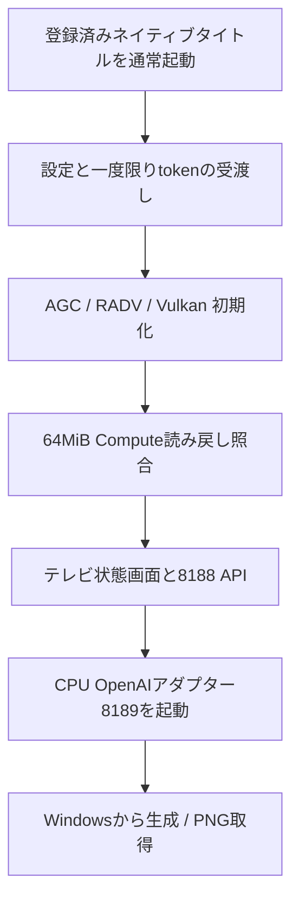

# 配置と運用

この版は既にネイティブHomebrewを起動できるFW12.40の検証環境を使っています。
初回登録・Jailbreak・互換payloadの導入を自動化したインストーラーではありません。
既存の登録・起動環境がないPS5へ、FTPでebootを置くだけでは起動しません。

## 検証済みレイアウト

```text
/data/ai/
├── models/                         元のモデル
├── output/                         確認済みPNGの保存
├── openai-gateway/                 CPUアダプター設定・ジョブ・出力
└── native-wai-direct/PPSA99188/
    ├── eboot.bin
    ├── sce_sys/param.json          PS5 AI WAI
    ├── sce_sys/icon0.png           WAIで生成した採用アイコン
    ├── sce_module/libc.prx         既存の検証済み公開runtime
    ├── models/                    ネイティブから /app0/models
    ├── licenses/
    └── ai-runtime/                ネイティブから /app0/ai-runtime
        ├── config.json
        ├── config/api-token       起動時だけ存在
        ├── jobs/
        ├── output/
        └── logs/
```

この登録済みタイトルには既存のアプリ用aliasがあります。今回の更新・検証でmountやシステムメタデータを変更していません。
このaliasを一般的なPS5に自動作成する処理は公開していません。
タイトルID PPSA99188を別アプリが使っている場合は上書きしないでください。

## 配置前に揃えるもの

自身のネイティブアプリが登録済みで、公開SystemServiceの通常起動・終了経路を使えることが前提です。
検証版はLaunchAppの引数に依存せず、native APIのパスとbind IPv4をコンパイル時に固定しています。
**`native/app/server.c`の`bind_ip`を自身のプライベートIPv4へ変更してから再ビルド**してください。
公開ソースの既定値は検証機のプライベートアドレスです。0.0.0.0や公開IPv4に変更しないでください。

ゲートウェイは`--root /data/ai/openai-gateway --bind <PS5_IP> --port 8189`を指定して起動します。
同じbind IPの8188へ転送するため、両者のIPを揃えます。
既存WebSrv8080は維持し、生成API機能をWebSrv本体へ追加していません。

## 設定と秘密トークン

エンジン設定は[config/native.json.example](../config/native.json.example)を基準にします。
実際のmodel copyのサイズ・全内容SHAを確認し、別モデルを同じファイル名で配置しないでください。
runtimeとconfigのディレクトリはアプリUID1・0700、トークンは0600で、32〜256の印刷可能ASCIIを使用します。
トークンをソース、URL、Git、共有スクリーンショットに含めないでください。

native bootstrapは設定と一度限りのトークンを待ちます。
既存環境では、所有者・起動時刻・タイトル・bootが確定してから設定とtokenを渡し、UID1/0700へ戻して解放しています。
途中でroot所有に戻したままGPU処理を継続するとアプリの書き込みを妨げます。
このshsrvでは`chown 1 PATH`の数値形式を使用し、`1:1`形式を使いません。
FTPのmetadataで実所有者を確認します。SDK statのUID欄だけで成功としません。

## 起動後の順序



`GET /health`を認証付きで確認し、GPU unavailableやdegradedのまま生成を繰り返さないでください。
モデルは最初の生成で読み込まれ、その後同じアプリ内で保持します。再起動後の初回読込は必要です。
生成中のweight staging/graph segment転送までゼロになるという意味ではありません。

## ログと復旧

| 場所 | 上限・用途 |
|---|---|
| `/download0/ai-native-bounded-logs-v2/` | startup / driver / pool、各4MiB×2世代、計最大24MiB |
| `/app0/ai-runtime/logs/engine.jsonl` | engine結果、16MiB×2世代 |
| `/app0/ai-runtime/` | bootstrap、API、ジョブ、画像。データ側 |

HTTPタイムアウトだけで再生成せず、既知のjob_idを確認します。
retained状態ではGPU資源を勝手に解放・再利用せず、本人のアプリID/PID/起動時刻を確認して通常のOS終了経路を使います。
ネイティブのshutdown409は、止まったワーカーを安全にjoinできないことを示します。
ゲートウェイの終了でネイティブGPUアプリを止める実装にはしていません。

本体やサービスの応答がなければ、自動でpayloadやアプリを重ねて起動しません。
本体を復帰した後、既存のFTP/Telnet/WebSrvを起動し、保存ログとモデル・タイトルの配置を確認します。
停止原因を確定できないままDirect Memory手動解放、予算値変更、システムファイルの書換えを行いません。
FW更新・初期化・外部公開はこの運用手順に含みません。
