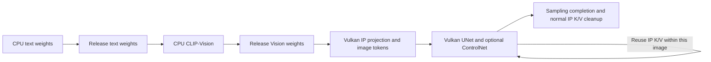

# IP-Adapterのメモリ寿命修正と実機検証（2026-10-19）

V18で、WAI-Illustrious-SDXL v17.0に漫画LoRA、IP-Adapter、OpenPose、マスク付きimg2imgを併用した1024×1024の生成に成功した。直前の要求からOpenPoseが読み込み済みの状態で、CPUテキスト条件を実際に再計算し、WindowsがOpenAI互換APIから取得したPNGとネイティブAPIのPNGが一致することを確認した。

この修正でDirect予約、GPUドライバー、シェーダー、演算精度、API仕様は変更していない。Direct予約は従来の9,879,683,072バイト（9,422MiB、9.201171875GiB）。対象はFW12.40で、システム領域への書き込みは行っていない。数値と検証範囲は[ip-lifecycle-20261019-evidence.json](ip-lifecycle-20261019-evidence.json)に記録した。

## 修正内容

変更した推論ソースは`core/diffusion_engine.cpp`と`core/image.cpp`の2ファイル。

- IP投影モデルと、UNetの名前が`model.diffusion_model.`で始まり`.attn2.to_k_ip.weight`または`.attn2.to_v_ip.weight`で終わる140個の重みを、同じVulkanバックエンド上の再読み込み可能なDisk residencyにした。UNetのIP重み650MiBと投影重み約158.24MiBを、通常の所有権・pin・runner cleanupに従って解放できる。WAI本体、LoRA、ControlNetの常駐方針はこの変更対象に含めていない。
- CPUテキスト条件を作成してそのrunnerを終了した後に、CLIP-Visionを実行する順序にした。CPUの両エンコーダーが同じDirectプールを借りるため、重みの寿命を分ける。作成済みの条件テンソルは維持する。

IPトークンの形状2048×16と有限値検査、既存のGPU実行確認、グラフ容量検査、実行中の重みを解放しない所有権検査は維持した。参照画像を使用しないグラフやIP強度0のグラフでは、登録されたIP重みを一括で読み込まないことをホスト上の依存関係検査で確認した。

## メモリ不足の原因

以前のV17の同系統要求では、CLIP-VisionのCPU重みを確保する第3チャンクで`no_contiguous_region`になっていた。要求の丸め後サイズは265,863,168バイトで、空き合計334,872,576バイトに対し、最大の空き区間は81,952,768バイトだった。最初の拒否には断片化という具体的な根拠がある。

さらに、このモデル経路で実測したVisionの重み全体は1,223,917,568バイトで、確保開始前の空き862,912,512バイトを上回っていた。したがって最初のチャンクだけを小さくしても、後続チャンクまで含む容量問題は残る。単純な予約量の増加を行わず、不要なIP重みの常駐とエンコーダーの寿命を修正した。

この拒否は当該要求のUNet・ControlNet推論より前に起きており、GPU計算の失敗やドライバー障害と同一視しない。確保済みCPUチャンクがエラー後に返却されたことも記録で確認した。この資料には失敗画像や生の失敗ログを添付していない。

## 1024×1024の全機能併用結果

要求は20 steps、CFG5、`euler_a`、seed20261018、漫画LoRA強度1、IP強度0.3、OpenPose強度1、denoise0.8。denoise後の実行ステップ数は17だった。参照画像、初期画像、準備済みポーズマップ、アルファ由来マスクの4入力を使用した。

|確認項目|実測結果|
|---|---:|
|PS5内の生成時間|141.356660秒|
|UNetの有限値検査済み出力|34回|
|ControlNet実行|34回|
|IP画像トークン|16個|
|非有限値|0|
|マスク適用|17回|
|編集対象外の画素|944,203画素|
|編集対象外で変化した画素|0|
|Direct使用ピーク|9,313,894,400バイト|
|ピーク時の予約内残量|565,788,672バイト|
|生成終了時のDirect使用量|8,169,750,528バイト|
|終了時のCPU重み用Direct借用量|0バイト|
|保持されたDirect障害状態|なし|

GPU上のIP attention・UNet・ControlNetの実行証跡を確認した。1回の生成POSTで完了し、自動再送は行っていない。取得PNGのSHA256は`8cc8fa0157cea42d3c29afc13a7b7e45052fde0772acadbee0ab8fe75056c8dd`。OpenAI互換APIとネイティブAPIから取得したPNGはバイト単位で一致した。

DirectピークはCPU借用も含むプールの高水位であり、GPU全体のVRAM使用量を意味しない。余りが正だったことから、任意の大きなモデルや組み合わせの成功までは保証しない。

## CPU重みの返却を実際に確認

今回の成功は、テキスト条件キャッシュだけを使って重い工程を飛ばした結果ではない。CPUテキスト重みの確保222回と解放222回を確認し、その工程内の同時借用ピークは1,535,901,696バイトだった。条件作成は14.12秒かかり、借用量が0になってからVisionの確保が始まった。

続くVisionは5回確保・5回解放し、同時借用ピークは1,223,917,568バイト、終了時0バイトだった。直前と同じアプリ所有者・同じOpenPoseの組み合わせで、ControlNetの重み準備34回の合計は0.019155秒。ControlNetを先に解放した新規起動だけで通過した検証ではない。

この大きな併用グラフではUNetが17区間に分かれ、34回のUNet評価に対して重み準備は578回、計4.856502秒だった。区間ごとの準備呼び出し数と、重みファイルを実際に読み直す回数は区別する。

## 速度比較の読み方

|条件|モデルの初期状態|生成時間|UNet計算呼出し合計|UNet重み準備合計|
|---|---|---:|---:|---:|
|V17、IP0.3、LoRAなし、ControlNetなし、20 steps|読み込み済み|95.858981秒|72.312563秒|0.075656秒|
|V18、同じ要求|未読み込み|126.310573秒|84.955169秒|16.591327秒|
|V18、IP0.7＋OpenPose、LoRAなし、20 steps|WAI読み込み済み、ControlNet初回|146.822596秒|72.402095秒|1.855557秒|

最初の2枚のPNGは同じSHA256 `6e3710803a600a61750721be8aa026478237fde7277c12cd292609120143ed3e`だった。この設定ではV18の寿命・順序修正による出力変化はなかった。

ただし、最初の2行は初期状態が異なり、126.31秒と95.86秒をそのまま定常性能の差とは扱えない。V18初回のサンプリング中には16.46秒の重み読込が1回あり、読込済みV17にはなかった。追加の重み準備16.52秒には対応する実測がある一方、計算呼出し合計の追加12.64秒については、GPUクロックやシェーダーコンパイルの直接計測がなく、原因を確定していない。別条件のV18読込済み要求ではUNet計算呼出し合計が72.40秒となった。

計測値はCPUから見た経過時間で、内部待機を含む。GPUの純粋な演算時間ではなく、入れ子の項目をすべて足すこともできない。全機能併用の141.36秒は17 stepsなので、20 stepsの上表と単純な高速化比較は行わない。

## 650MiBを各ステップで読み直しているか

確認した要求では、その挙動は起きていない。UNetの`compute`は`auto_runner_end=false`で、区間終了はpin数を戻すだけ。sampling全体の終了時にrunner cleanupする。V18初回はサンプリング中の読込1回、続くIP＋OpenPose要求は新規ControlNetの7.29秒とUNet側IP重みの1.77秒の2回で、その後の40回のUNet評価中に追加の読込はなかった。

IP重みは画像単位で解放するため、次のIP画像には1回の再読込コストがある。一方、全画像を通じて重みを固定すると、次のCPUエンコーダーに必要な空きを奪う。確認されていない「各ステップの再読込」を理由に、新しい固定pinを追加してはいない。

なお、`weight_tensor_copy_set`の67回・2,449,036バイトという値は、`ModelLoader`の主要なファイル読込経路をすべて含まない。これをモデル転送総量と見なさない。

## ホスト検査と公開ビルド

重み所有権・pin・解放のホスト検査45項目、IP未使用時のグラフ依存関係12項目、変更した2翻訳単位の構文検査が通過した。固定済みV18ソースは維持し、既存の公開ビルド手順でも外部チェックアウトから完全ビルドした。128個のスナップショットハッシュ、パッチの適用・全オーバーレイ再構成、SELF構造、strip前後のロード領域、実行時プロバイダー、コンストラクター、依存アーカイブとソース入力を検査した。

実機で上記を検証したネイティブSELFのSHA256は`512c3d9e04b2d520d2847c89c61e228a05948bfb8893cc097aad2b49338f6c5b`。公開手順から別に作ったSELFは`20256bca2cb607bef806e36f5b9e22b0052fbd8963cae7be5bb078ba2f72c98a`で、同一バイナリではなく、この公開手順のSELF自体はPS5で実行していない。ホストでの公開ビルド成功と実機検証済みバイナリは区別する。

この検証の実行成功、有限値、マスク外の画素保存は確認済み。一方、汎用SDXL IP-Adapterで参照キャラクターの顔・衣装・画風を十分維持できるかは品質改善の対象に残る。生成の完了やPNGの取得だけで、同一キャラクターの再現や希望した編集内容の達成とは判定しない。他のマスク形式や連続生成を含む全体の確認状況は[機能別の検証記録](feature-classification-20261019.md)で扱う。

## 通信切断後の結果回収

生成中の通信切断も1件検証しました。GPUサンプリング開始後、進捗0.32（20steps中の少なくとも6steps完了に対応）で接続を閉じても、PS5上の生成は142.042663秒で完了しました。生成POSTは1回・自動再送0回で、別途回収したgateway経由とnativeのPNGは一致しました。切断した元の同期応答を受け取ったという意味ではなく、キャンセル・電源断・GPU障害の復旧試験でもありません。

## 連続6件と通常のアプリ再起動

WAI＋漫画LoRA＋OpenPose、1024×1024／20stepsをA/B/C/A/B/Cの順で6件生成し、124.176〜124.446秒、中央値124.199秒だった。後半3件／前半3件の中央値比は1.0001106で、この区間に4〜5倍の低下は再現しなかった。全件でGPU有限値検査、CPU借用の返却、同一プロンプト対のPNG一致を確認した。終了時のDirect使用量は全件8,170,340,352バイトで一定だった。今回のプロンプトは258〜260 UTF-8 bytesの短文で、元の768×1024・約1.7〜2.0KBの長文カタログとは異なり、旧条件を厳密に再現した試験ではない。

運用検証時のプロセス生涯Directピークは9,705,046,016バイト、予約内残量は174,637,056バイト（約166.55MiB）。先の全機能併用1件のピークとは別の高水位で、CPU借用も含む。これを画像ごとの専用VRAM量として足し合わせない。

切断後のジョブIDは運用者権限で既存の内部対応ログから特定した。通常の同期OpenAIクライアントがID受信前に切断した際、未知の受付済みジョブを確実に検索できるAPIは未提供。相関IDやidempotencyは改善候補で、結果不明の生成POSTは自動再送しない。切断試験後の通常OpenAI生成は同じプロセスで成功した。

通常のOS経路でのアプリ再起動では、合成queued/running記録のfailed化と既存PNGの保存、起動時64MiB Compute読み戻しを確認した。実際のGPUジョブの強制中断、GPUハング、本体の突然の電源断からの復旧を確認した結果ではない。6件は代表条件の回帰確認であり、24時間・全カタログ・全パラメーター組合せの保証ではない。

[運用・復旧の実機結果](operations-recovery-20261019.txt)・[機械可読値](operations-recovery-20261019-evidence.json)。
