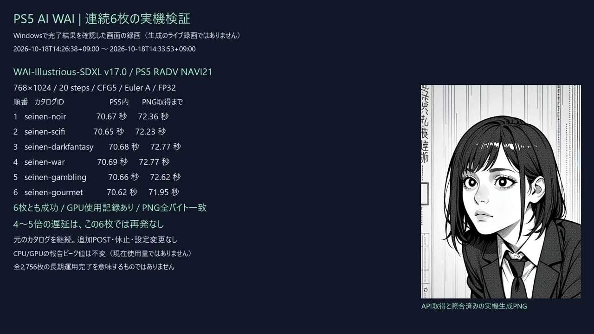

# 通常運用のログと速度改善

2026-10-18 JST、FW12.40のPS5実機でnormalモードを検証しました。
WAI-Illustrious-SDXL v17.0、768×1024、20steps、CFG5、Euler A、seed20261018、negative指定なし。

| 同じプロンプトの状態 | PS5生成時間 | WindowsでPNG取得まで |
|---|---:|---:|
| 変更前・遅延中 | 417.90秒 | — |
| 変更前・5分休止後 | 115.20秒 | 116.61秒 |
| 変更後・初回モデル読み込みを含む | 92.47秒 | 記録なし |
| 変更後・モデル読み込み済み | **57.06秒** | **58.17秒** |

全ケースで同じPNGになりました。941,994 bytes、SHA256：
`763b3eca54fda750cbc03081570dafb0d3127824abc0a834c70ae493175ba8cd`。
warmはconditioning cacheがhitし、CLIP0.00秒。旧ケースのCLIP約7秒との差も含むため、
時間差の全てをログ変更の効果とは扱いません。
samplingは392.28→56.13秒、decodeは17.42→0.73秒へ短縮。
その後の別プロンプト8枚はPS5内72.34～72.42秒、Windows取得73.97～74.14秒でした。
これらは通常カタログの再開結果で、追加の8枚をテスト用に生成したものではありません。
長期耐久試験の完了を意味しません。


## 連続6枚の追加確認

2026-10-18 14:26:38～14:33:53 JST、元のカタログを休止せず、異なるプロンプトを順に生成しました。
遅延発生時は4枚目から低下し、6枚目まで遅延が記録されたため、連続6枚を確認対象にしました。
768×1024・20steps・CFG5・Euler A・seed20261018・negative指定なしを維持しています。

| 順番 | PS5内生成時間 | WindowsでPNG取得まで |
|---:|---:|---:|
| 1 | 70.670秒 | 72.36秒 |
| 2 | 70.648秒 | 72.23秒 |
| 3 | 70.683秒 | 72.77秒 |
| 4 | 70.687秒 | 72.77秒 |
| 5 | 70.659秒 | 72.62秒 |
| 6 | 70.623秒 | 71.95秒 |

6枚ともcompleted、GPU使用記録あり、エラーなし。OpenAI互換クライアントが保存した各PNGと、
ネイティブAPIのGETで取得したPNGは全バイト一致し、PNG全デコードも成功しました。
ジョブ間の間隔は0～1秒で、追加生成POST・休止・プロセス再起動・PS5設定変更は行っていません。
ネイティブAPIとゲートウェイは同じPID・started_atのまま継続しました。

後半3枚／前半3枚の生成時間中央値の比は0.9998で、この6枚では4～5倍の遅延は再発していません。
報告されたCPUピーク9,098,674,176 bytes、GPUピーク5,404,590,080 bytesも6枚で不変でした。
これらはプロセス／所有プールの生存期間のピークで、現在使用量や全VRAMの測定値ではありません。
値が不変でもメモリリークがない証明にはならず、全カタログの長期運用完了も意味しません。

[](media/log-modes-continuous-six.mp4)

[16秒のWindows結果確認動画](media/log-modes-continuous-six.mp4)です。
完了結果を表示した実際のWindows画面の録画で、生成のライブ録画ではありません。
正確な数値とPNGハッシュは[logging-verification.json](logging-verification.json)の
`continuous_catalog_followup`にあります。

## normalとdebug

未指定はnormalです。設定に次を追加するとdebugになります。これは設定全体ではなく追加項目です。

```json
{"logging":{"level":"debug"}}
```

AGC初期化前に1回だけ固定し、切り替えは通常のアプリ再起動時に行います。

| 記録 | normal | debug |
|---|---|---|
| GPU submit・fence・SuspendPointごとの正常追跡 | 省略、集計を保持 | 詳細 |
| 正常な割り当て・解放・内部cleanup | 省略、使用量・peakを保持 | 詳細 |
| 開始・完了、工程時間、モデル状態、GPU使用証跡 | 保持 | 保持 |
| 警告・エラー・異常戻り値・retention・重要な完了境界 | 保持・即時同期 | 保持・即時同期 |
| SD.cpp DEBUG/VERBOSE・splitされた全文プロンプト | 省略 | 詳細 |
| グラフのデータ・scratchメモリ計画 | 現段階は診断用に保持 | 保持 |
| 重複するraw stderrファイル | 作成しない | 作成しない |

normalでも実際のGPU戻り値検査、フェンス・quiet確認、メモリ計画検証、有限値検査は実行します。
ログを省略してGPUの失敗を成功扱いにする変更ではありません。
warmでは350,510件を整形・書き込み前に省略。
測定したstartup/driverのfsyncは合計24回、待ち時間合計約36ms。
変更前の遅延ログ例では同サイズ・同stepsで約5,500回、数百秒の待ち時間でした。
集計にはローテーション等の別I/Oを含まず、別スレッドの累計時間は壁時計時間と区別します。

通常モードに残るグラフ計画は300件で、engineログ全体は316イベント・192,710 bytes/枚でした。
debug時の定例ログも1,024件／512KiB／1秒経過でまとめて同期します。
1秒は次の記録時に検査する条件で、アイドル時のタイマー保証ではありません。
重要記録、失敗、最終チェックポイントは即時同期します。

## ログの保持容量

| 継続ログ | 1セグメント | 世代 | 合計 |
|---|---:|---:|---:|
| startup / driver / pool | 各4MiB | 各2 | 24MiB |
| engine.jsonl | 16MiB | 2 | 32MiB |
| ネイティブAPI api.log | 2MiB | 2 | 4MiB |
| OpenAIゲートウェイ api.log | 2MiB | 2 | 4MiB |
| **主要な継続ログ** | | | **64MiB** |

download側は24MiB枠で、残りはdata側です。生成を続けても主要ログの保持容量は増え続けません。
起動ごとの小さなbootstrap・witness、開発操作の一度限りの証跡は別枠。
生成画像・ジョブ履歴も別枠で、自動削除しません。
既に上限を超えていた旧ログは、移行時のpreviousを別途回収してください。
今回の実機ファイルは全て上限内です。

GPUの演算・submit/fence・メモリ所有の実装、モデル、FP32、6GiB Directプールを維持しました。
起動時の精度読み戻し2件・畳み込み検査4件、40回のUNet出力検査、NaN/Inf0を確認。
同画像のdispatch137,630／submit29,143／fence29,143も変更前と一致。
これらはGPU使用率の測定値ではありません。

実機で実行したバイナリのSHA256は
`a1ec807794ab605e7c814cc12328ce54208bcaa1f68af2dd05a8400e21f51807`。
公開ソースの別ビルドはSELF整合性まで検査し、実機実行したバイナリとは区別しています。
記録は[logging-verification.json](logging-verification.json)、ソース対応は[source-snapshot.json](source-snapshot.json)。

## 2026-10-19：Direct poolと通常解放の同期境界

ControlNet利用時に正常Direct解放のphase名がnormalの既存一覧から漏れていた問題を修正しました。checked recordは全件保持し、正常なpoolの割当・import・返却だけ同期を128件/64KiB/1秒（次の記録時に判定）へまとめ、PNG公開前に必須checkpointを追加しました。異常、debug、初期化・終了、物理allocation/mappingは即時同期を維持します。current/previous容量制限も維持しました。[工程別実測と回帰テスト](unet-profiling.md)を参照してください。
