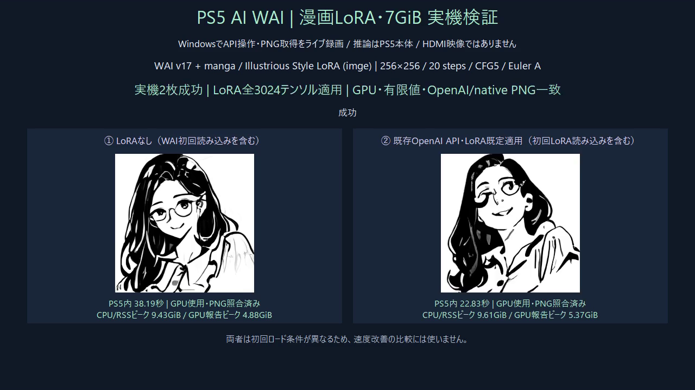
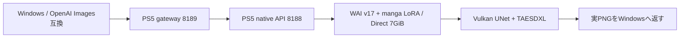

# 漫画LoRA・7GiB Direct 実機成功記録（2026-10-18 JST）

WAI-Illustrious-SDXL v17.0に、imge作「manga | Illustrious Style Lora」を適用した。既存8188/8189と同じモデル名・リクエストで、漫画LoRA強度1.0とmonochromeを標準適用する。

256×256 / 20 steps / CFG5 / Euler A / seed20261018。同じprompt/negative_promptで比較した。
| 条件 | PS5内生成時間 | WindowsでPNG取得まで | GPU報告ピーク | プロセスRSSピーク |
|---|---:|---:|---:|---:|
| LoRAなし：WAI初回読み込みあり | 38.187526秒 | 39.219秒 | 4.877GiB | 9.429GiB |
| LoRAあり：WAI読み込み済み・LoRA初回読み込みあり | 22.828582秒 | 23.578秒 | 5.374GiB | 9.606GiB |

**初回ロード条件が異なるため、LoRAによる高速化を示す比較ではない。** 最初はGPU側のキャッシュ準備も含み得る。RSSはGPU共有マッピングを含み、CPU専用メモリではない。GPU報告ピークとも合算しない。

2枚ともcompleted、gpu_used=true、PNG全デコード成功。OpenAI互換応答のPNGはネイティブGETのPNGと全バイト一致。漫画LoRAはText Encoder 774/774、UNet 2250/2250、合計3024/3024テンソル適用を確認し、非互換によるskipは0。20回のUNet出力検査でNaN/Infは0。GPUの完了済みUNet/Flash Attention witness、submit/fence完了も確認した。

LoRAなしの生成も白黒になったため、カラーから白黒への変化を証明する比較ではない。LoRA適用ログと出力の差を確認した。小画像の目視だけで1024での漫画品質や人物固定を保証しない。

## メモリの実測

Direct data poolは7,516,192,768 bytes（7GiB）、28×256MiB。model manager予算6.75GiB、初期admission余白1GiBを維持。CPU専用1GiBの枠ではない。起動後64MiBのGPU Compute読み戻し一致を確認した。7GiB全域のGPU読み戻し試験ではない。
LoRA生成後のDirect data使用量5,664,784,384 bytes、同ピーク5,725,995,008 bytes、プール内free 1,851,408,384 bytes。GPU報告ピークにはdriver側も含む。
CPU heapの生成後mapped 2,367,422,464 bytes、peak mapped 2,536,374,272 bytes、libc fallback 0。CPU heap内部の空きは未取得。
アプリ自身のAvailableDirectMemorySize queryは成功し、生成後の最大連続spanは2,076,180,480 bytes（約1.934GiB）。全空き容量ではない。query canary一致。

## API・運用

OpenAI互換API8189の既存リクエストにはmanga指定を足していない。native8188では比較用にmanga_strength=0を指定可能。0..1.5の有限値を受理し、既定は1。
カタログは217枚完了時に安全停止し、通常OS終了で旧nativeアプリを閉じた。旧SELF・旧configを/data/aiとDドライブへ保存。1回だけ新アプリを通常起動し、既存gateway・FTP・Telnet・WebSrv等を維持。FW更新・システム領域への直接書き込み・GPUメモリの手動解放は0。
2枚の検証後に元のカタログを再開。以後の生成は漫画LoRAが標準適用される。既存画像は再生成していない。切替境界をcatalog側のmanga-style-boundary-20261018.jsonに保存した。
生成PNGはnative runtimeのoutputと/data/ai/outputに保存した。
img2img/IP-Adapterは別途ソース・ELF・重みヘッダー調査を完了したが、画像入力APIの接続・PS5参照画像生成はまだ実装/検証していない。

## 重み・再現

原作者imge：https://civitai.com/models/1745962?modelVersionId=1976014。作者クレジットを維持し、重み本体は公開GitHubへ同梱しない。
旧GLoRAをこのWAI専用の通常LoRA rank48/F32へ数学的に変換。SVD・rank切詰めなし。clip_skip=2で未使用のCLIP-L最終層6対象を除き、使用1008層すべてをfloat64基準のサンプル補正と照合した。
変換済みSHA256：`764e32941b1a6fb4148cc2f700306f36d34c731238c3643249ecc15b29871f68`。
実機SELF SHA256：`0eaebfeabdebcc81a40af57b6ad210887f5d73f83548f72f1aaf0241765176d3`。

動画はWindowsのAPI操作・実PNG取得のライブ録画。短縮版24秒は待ち時間の一部をカットし、再生速度は変更していない。全体版91秒も保存。PS5のHDMI映像ではない。

旧版へ戻す場合は、その時点のPID/start/app IDとidleを確認して通常OS終了し、退避したSELF/configをハッシュ照合後に戻して通常起動する。実行中ファイルを書き換えず、起動や生成を不明なまま再送しない。

## 実画像と録画

[24秒のライブ検証短縮版](media/manga-verification.mp4)。待ち時間を一部省略。

## 公開ソースの再ビルド

公開用のnative 11翻訳単位・RADV platform・core runnerを再ビルドし、SELF integrity valid、24 constructorと動的import/providerが実機版と一致することを確認した。公開ソースのparser10件・pool26シナリオ・変換代数25件も合格。公開用再ビルドのSELFは実機へ再配備しておらず、実機版と別の識別値として記録する。[再ビルド記録](manga-build-verification.json)。
