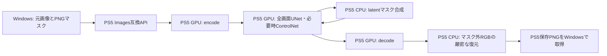

# マスク付きimg2img / Inpaintingの実機検証（2026-10-19）

WAI-Illustrious-SDXL v17.0を使い、OpenAI互換 `POST /v1/images/edits` からマスク編集をPS5で各1回実行した。Windowsは入力の準備・転送・API操作・PNG取得・画素比較のみ行い、モデル推論は行っていない。

|出力|マスク|併用|PS5内生成時間|マスク外の変更|内側の変更|
|---|---|---|---:|---:|---:|
|256×256|白黒|漫画LoRA1|63.217秒|0画素 / 保持59,009画素|6,527画素|
|1024×1024|透過PNG|漫画LoRA1＋OpenPose|172.897秒|0画素 / 保持944,224画素|104,352画素|

両方とも20指定ステップ、変換強度0.8による実行17ステップ、CFG5、Euler A、seed20261018、monochrome自動付与なし。256はモデル未読み込みから、1024はControlNetを有効化した条件であり、モデル構成・解像度・読み込み範囲が異なる。両値の比率を高速化率として扱わない。各1回の機能確認で長時間安定性の証明ではない。

マスク準備・17回のlatent合成・完了済みGPU UNet演算・有限値を確認し、NaN/Infは0。1024ではOpenPose GPU実行と10残差テンソルも確認した。OpenAI互換応答とnative保存PNGは全バイト一致。CPU CLIP用Direct借用は生成後0、入力のleaseも返却され、検証用入力を回収した。最後に両API待機、画面更新、既存サービスを確認した。

**編集範囲の保持と変更は確認できたが、指定した赤いスカートにはならなかった。** 256は暗い青黒系、1024は青緑系のままで、主に折り目や陰影が変化した。両画像は目視済みだが、指定色・仕上がり品質の合格とはしていない。マスク外の顔・髪・服・背景はRGB比較で元画像と一致する。顔の新規生成や同一人物固定の品質を検証したものではない。

WAIの通常checkpointを使うmasked img2imgで、専用inpaintingモデルは追加していない。UNetは全画面をGPUで計算し、latent合成と最後のRGB合成はPS5 CPUで行う。ROIだけの推論ではなく、マスクを小さくしても計算量が比例して減るとは主張しない。

Direct予約9422MiB（約9.201GiB）、推論予算8.75GiB、CPU初期reserve1GiB、CPU CLIP重み16MiB目安、FP32、GPUドライバー・設定を維持した。所有プールのピークにはCPU CLIP借用が含まれ、専用VRAM使用量ではない。RSSと単純に加算しない。

二値の白黒・透過マスクを実機で検証した。柔らかい境界の品質、IP-Adapterも同時に有効にした構成、全編集マスクの実機生成は今回未検証。全編集latentの合成評価回数0を正しく許容する判定は、推論をしないホストのメタデータ検査で確認した。プロトコルの併用対応を、あらゆる組み合わせでのメモリ・画質保証と読み替えない。

各条件の生成POSTは1回、自動再送0。今後はユーザー方針により検証動画を撮影せず、生成画像・文章・実測・ログを残す。今回の添付キャラクター画像は公開リポジトリへ追加していない。

[APIとマスク仕様](mask-api.md)、[実測と証拠のハッシュ](masked-inpainting-20261019-evidence.json)。公開用ソースからの再ビルドと、実機で使用したSELFは別の成果物として扱う。
