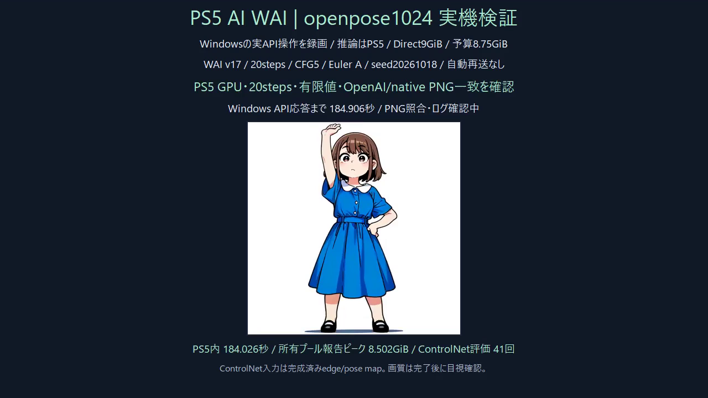

# UNet工程別計測・ログ同期・表示色の修正（2026-10-19）

FW12.40の同じPS5で、WAI v17.0、OpenPose、1024×1024、20steps、CFG5、Euler A、seed20261018、漫画LoRA1、自動monochromeなし、同じプロンプト・negative・入力mapを使いました。両回ともアプリを通常終了後に起動し、モデル未読込から生成しています。予約9GiB・18個の512MiB region・予算8.75GiB、RADVとFP32演算を維持しました。

| 比較 | PS5内生成 | モデル状態 |
|---|---:|---|
| v8・計測のみ、同期変更前 | 194.543737秒 | 初回 |
| v10・ログ同期＋BGRA表示形式修正 | 184.026332秒 | 初回 |

今回は約10.52秒、約5.4%短縮しました。各1枚の観測で、長期の速度保証・統計的な速度比較ではありません。v10のWindows/OpenAI応答は184.906秒。Windowsで推論はしていません。

20 sampler steps、UNet・ControlNet・TAESDXLのVulkan経路、NaN/Inf0、CPU CLIP一時借用の返却0、OpenAI/native PNG全バイト一致を確認しました。修正前のv7・v8ともPNGが完全一致しました。

PNG SHA256 `98eaa144fa64e8160352709df84f34420249d09023f03e108682d95de9dd8b0d`。初回CFGバッチは1回失敗し、そのstepだけGPU上で条件を1件ずつ計算する代替経路になりました。CPUでのUNet推論への切り替えではありません。成功UNet出力21回、失敗を含むgraph_total22回、ControlNet41回を記録しました。全stepの完全バッチ化を達成したとは扱いません。

## CPUで観測した内訳

これは呼び出し前後のCLOCK_MONOTONICによるCPU側経過時間です。**GPUタイムスタンプではありません。** graph_callには内部GPU待ち、weight_prepareには読込・配置・容量調整、workspaceにはメモリ管理とそのログ処理が含まれます。graph_totalやcleanupなどには包含関係があるため、列を合計して生成時間と比較しないでください。

| 計測区間 | v8 秒 | v10 秒 |
|---|---:|---:|
| `unet.graph_total` | 115.336936 | 105.421987 |
| `unet.graph_call_including_internal_wait` | 79.412522 | 80.810967 |
| `unet.weight_prepare_including_capacity` | 19.969031 | 18.958531 |
| `unet.workspace_prepare_allocate` | 9.058852 | 1.718110 |
| `unet.activation_upload` | 0.365722 | 0.366147 |
| `unet.output_capture_readback` | 2.464205 | 0.899616 |
| `unet.explicit_workspace_wait` | 0.013990 | 0.016127 |
| `controlnet.graph_total` | 47.803109 | 47.345404 |
| `Direct_pool_log_fsync` | 7.485292 | 0.183589 |
| `startup_log_fsync` | 5.246403 | 0.147166 |
| `engine_structured_log` | 2.263281 | 2.284576 |

UNetのgraph_callは複数分割グラフの合計です。activation_uploadは観測した入力転送呼び出しで、全PCIe/メモリ転送の総量ではありません。重みコピーの観測範囲も一部に限られます。明示的workspace waitだけが小さくても、内部待ちが無いとは言えません。

v10で追加した、ログを除くbackend idle pollingは0.124910秒／124476回でした。ログを含むquiescence呼び出しは0.478794秒です。どちらも対象箇所のCPU経過時間であり、全GPU同期の総量ではありません。全計測のinvalid clockは0です。

## 修正したログ同期

正常なDirectバッファ解放のphase名`native_Direct_owned_buffer_free`が、normal用の既存一覧と一致せず、通常処理でも即時fsyncになっていました。正常import記録にも同じ即時同期がありました。以前のv7観測では、Canny/OpenPose両方3588回のstartup fsyncにそれぞれ5.971878秒／77.135470秒を使っていました。差71.16秒は遅延の一部を直接説明しますが、全生成時間差や熱・クロックの原因を特定したものではありません。

v10は正常処理のchecked recordを保持したまま同期をまとめます。startupは既存のnormal境界、poolは128件／64KiB／1秒（次の書き込み時に判定）で同期します。PNG公開前に必須のpool checkpointを追加しました。debug、初期化、終了、物理割当・mapping、異常時の即時同期は維持しています。GPUの状態照会、fence、所有権・返却の検査は省略していません。

- pool fsync：5016→98回、7.485292→0.183589秒。
- startup fsync：3597→98回、5.246403→0.147166秒。
- GPU quiescence照会回数は双方124476回で維持。成功記録そのものは減らしていません。既存のcurrent＋previous各4MiBなどの容量制限も維持しました。

v8では以前の77秒のstartup fsyncは再現していません。したがって以前の329.68秒と今回184.03秒の全差を、この修正の効果とは扱いません。CPU温度・GPUクロックは未測定です。残る最大の観測区間はUNet graph_callで、GPU演算と内部待ちの分離は今後の課題です。

## 連続領域不足の実測

poolの割当失敗時にbitmapを確認する診断を追加しました。同じジョブで要求167772160B（160MiB）、総空き799571968B（762.53MiB）、最大連続空き159383552B（152MiB）、region上限512MiBを記録しました。総空きよりも連続空きが不足する断片化を実測できました。予約全体が単純に不足した証拠ではありません。

初回CFG代替も同じジョブで観測しました。割当失敗とその代替経路の直接の因果関係を特定したものではありません。次は大きな作業バッファと持続する重みの配置順を見直す候補です。この版ではallocator配置、予約量、CPU/GPU演算は変えていません。poolピーク8.502GiBはCPU一時借用も含む所有プールのプロセスピークで、GPU専用VRAM使用量ではありません。peak RSSも共有mappingを含み得るため足し合わせません。

## アプリの表示色とアイコン

ユーザー写真で赤紫のカードと色の変わったキャラクターを確認しました。CPUがBGRA順で書く一方、VideoOutは別形式`0x8000000022000000`でした。[参考実装の実測BGRA SDR形式](https://github.com/mihawk-99/PS5_Vulkan/blob/f410e67a0241b3e8edcdbcd2a9b285dfc4a412ed/docs/HARDWARE_FINDINGS.md#L54)の`0x8000000000000000`へ、表示属性1箇所だけを変更しました。32MiBの表示メモリ、描画、flip、寿命、約1秒更新は維持しています。

CPUでR/G/Bのbyte順と全2073600画素のtiled/linear一致、境界を検証し、実機の表示完了・heartbeat継続・表示fault0を確認しました。TV上の配色はユーザー確認待ちです。


これはWindows上のCPUプレビューで、PS5 HDMIの画像ではありません。

ホーム側はユーザー写真で旧アイコンのままと確認しました。配置済みPNG4件は新キャラクターと全SHA一致ですが、登録情報のicon0Infoは古いキャッシュ識別子付きでした。画像ファイル更新とホーム表示の反映は別です。読み取り調査に留め、DB直接編集・ShellUI強制終了・本体再起動はしていません。ホーム更新成功とは扱いません。

## 保存した証拠と復旧

実機使用SELFのSHA256は`31e28c339ad0cc42691478253e083bf4c456c3f9ebca5ba7b84e82e694a44b2d`です。公開ソースの再ビルドは別成果物であり、そのSELFを実機実行したという意味ではありません。

前SELFと設定を保持し、検証前にカタログを現在の1枚完了後のSTOP状態に維持しました。PID・開始時刻・boot・アプリIDを確認し、OSの通常終了で差し替え、GPU64MiB読み戻し16777216値・mismatch0を確認してから生成しました。プロセス強制終了・GPU手動解放・FW更新はしていません。

通常復旧は現在のジョブの完了とidleを確認してからアプリをOSで終了し、保存済みSELFへ戻して通常起動します。PIDだけを信用したkillや重複起動はしません。調査が終わった時点でカタログは停止のままです。

Windowsホスト回帰テストはchecked record200件の保持、128件/64KiB/1秒の境界、debug/初期化の即時同期、最終checkpoint、同期失敗時のsticky faultを検証しました。モデル推論・PS5接続はありません。計測ヘルパーも区間識別、nested scope、errno/戻り値保持、無効時の未計測を確認しました。

```powershell
python tests/direct_logsync_host.py --compiler <mingw-clang.exe> --out <host-test-output>
# phase_profile_host.cppはnative/appをincludeし、-UNDEBUG -lwinpthread付きでWindows用にビルド。
```

[](media/controlnet-openpose1024-logsync.mp4)

動画は実Windows API操作録画の完了部分12秒です。PS5内の生成時間は184.03秒であり、動画の長さが生成時間という意味ではありません。PS5 HDMIの録画ではありません。公開ソースの再ビルド・SELF整合性・24 constructorの順序と外部import一致・Windowsホスト回帰テストも通過しました。公開版再ビルドSELFの実機再実行は行っていません。
